# Product Requirements Document (PRD) — Frontend Implementation
## Sistem Pengajuan Berbasis Template & Alur Verifikasi Dinamis Polibatam-Surat

| Informasi Dokumen | Keterangan |
| :--- | :--- |
| **Aplikasi** | Polibatam-Surat (Frontend Web) |
| **Framework / Stack** | Vue 3 (Composition API / `<script setup>`), Vuetify 3, Vuex / Pinia, Axios |
| **Versi Dokumen** | 1.0 — Ready for Development |
| **Tanggal Rilis** | 16 November 2026 |
| **Target Tim** | Tim Frontend PBL & Pengembang Antarmuka |

---

## 1. Latar Belakang & Tujuan Produk

Berdasarkan evaluasi terhadap alur kerja pengajuan surat di Politeknik Negeri Batam, tim pengusul (dosen/staf) mengalami kesulitan saat harus menyusun klausul konsiderans hukum (*Menimbang*, *Mengingat*, *Menetapkan*) secara manual dari awal. Hal ini menyebabkan antrean verifikasi terhambat oleh revisi redaksional berulang kali.

Dokumen PRD ini menjadi panduan teknis implementasi sisi antarmuka (*frontend*) untuk merealisasikan dua solusi utama:
1. **Template-Driven Submission (Pengajuan Berbasis Template):** Pengusul cukup memilih jenis surat/template yang diinginkan dan mengisi formulir variabel dinamis (misal: nama kegiatan, tanggal, ketua panitia). Naskah hukum dan tata letak kop dikunci secara baku oleh sistem.
2. **Dinamisasi Alur & Antarmuka Verifikator:** Menyambungkan antarmuka pengaturan verifikator admin (`setup/verification.vue`) ke backend dinamis, menyediakan antrean verifikasi multi-tahap yang rapi bagi pejabat penelaah, dan menampilkan stepper pelacak status yang informatif bagi pengusul.

---

## 2. Peta Arsitektur Halaman & Komponen Frontend

```mermaid
graph TD
    subgraph Pengusul [Area Pengusul / Pemohon]
        A1[submission/form.vue] --> A2[Step 1: Katalog Pemilihan Template]
        A2 --> A3[Step 2: Dynamic Form Generator]
        A3 --> A4[Step 3: Pratinjau & Upload Lampiran]
        A4 --> A5[Detail Surat: submission/_id_.vue]
        A5 --> A6[VerificationStepper.vue]
    end

    subgraph Verifikator [Area Verifikator]
        B1[verification/index.vue] --> B2[Tab Antrean Tahap 1 / 2 / 3]
        B2 --> B3[VerificationDecisionDialog.vue]
    end

    subgraph Admin [Area Admin / Urusan Administrasi]
        C1[setup/template.vue] --> C2[Form Upload & Auto-Scan DOCX]
        C3[setup/verification.vue] --> C4[VerifierPickerDialog.vue]
    end

    subgraph GlobalNavbar [Komponen Global]
        N1[AppNotification.vue / Lonceng Navbar]
    end
```



---

## 3. Spesifikasi Rinci Modul & Antarmuka (Pages & Views)

### 3.1 Modul Pengusul: Pengajuan Berbasis Template (`pages/submission/form.vue`)

#### User Journey:
1. Pengusul mengklik tombol **"Ajukan Surat"**.
2. Sistem menyajikan **Katalog Template** (kartu-kartu kategori: SK Kegiatan, SK Pembimbing, dsb.).
3. Setelah template dipilih, form otomatis merender *input fields* dinamis sesuai array `schema_fields` yang diterima dari API.
4. Input konsiderans hukum (*Menimbang/Mengingat*) tidak lagi ditampilkan secara manual, digantikan oleh ringkasan konsiderans otomatis yang terkunci.
5. Tersedia tombol **"Simpan Draf"** (`status: DRAFT`) dan **"Ajukan Sekarang"** (`status: POSTED`).

#### Komponen Form Generator Dinamis:
Form dibangun secara reaktif dengan memetakan `template.schema_fields`:
```html
<template v-for="field in activeTemplate.schema_fields" :key="field.key">
  <!-- Tipe Teks -->
  <VTextField
    v-if="field.type === 'text'"
    v-model="formValues[field.key]"
    :label="field.label"
    :placeholder="field.placeholder"
    :rules="field.required ? [v => !!v || `${field.label} wajib diisi`] : []"
  />

  <!-- Tipe Angka / Tahun -->
  <VTextField
    v-else-if="field.type === 'number'"
    v-model.number="formValues[field.key]"
    type="number"
    :label="field.label"
  />

  <!-- Tipe Tanggal -->
  <VTextField
    v-else-if="field.type === 'date'"
    v-model="formValues[field.key]"
    type="date"
    :label="field.label"
  />

  <!-- Tipe Pilihan (Select / Dropdown) -->
  <VSelect
    v-else-if="field.type === 'select'"
    v-model="formValues[field.key]"
    :items="field.options"
    :label="field.label"
  />
</template>
```

---

### 3.2 Modul Admin: Manajemen Template Dokumen (`pages/setup/template.vue`)

#### Fungsionalitas Utama:
1. **Daftar Template Aktif:** Tabel data berisi Kode, Judul, Kategori, Status Aktif (Switch toggle), dan tombol Aksi (Edit / Hapus).
2. **Dialog Tambah / Edit Template:**
   - Input metadata: Judul, Kode (misal `TPL-SK-PANITIA-01`), Kategori surat, dan Deskripsi peruntukan.
   - Unggah file template master `.docx` ber-tag (misal `{nama_kegiatan}`, `{tanggal_mulai}`).
3. **Fitur Cerdas "Pindai Tag Dokumen" (Auto-Scan):**
   - Saat admin memilih file `.docx`, frontend memanggil `POST /templates/scan-variables`.
   - Backend memindai tag placeholder di dalam file Word dan mengembalikan daftar nama tag.
   - Form builder secara otomatis menyusun baris field konfigurasi (Key, Label, Tipe Data, Wajib/Opsional) sehingga admin tidak perlu mengetik nama field satu per satu.

---

### 3.3 Modul Admin: Pengaturan Verifikasi (`pages/setup/verification.vue`)

Antarmuka ini sudah tersedia pada sistem, dan kini didukung penuh oleh endpoint backend dinamis:
1. **Inisialisasi Data:** Memanggil `GET /verification/stages`.
2. **Tambah Verifikator:** Admin memilih pegawai pada `VerifierPickerDialog`, lalu frontend memanggil:
   ```ts
   POST /verification/stages/:stage/verifiers
   Payload: { nip: "..." }
   ```
3. **Hapus Verifikator:** Menekan ikon tempat sampah pada kartu tahap:
   ```ts
   DELETE /verification/stages/:stage/verifiers/:nip
   ```
4. **Indikator Unit Pengusul:** Pada Kartu Tahap 1, tampilkan badge *"Otomatis Mengikuti Pimpinan Unit Pengusul"* untuk memperjelas alur kerja.

---

### 3.4 Modul Verifikator: Daftar Persetujuan (`pages/verification/index.vue`)

#### Komponen Utama:
1. **Tab Navigasi Tahapan:**
   - Tab 1: Verifikasi Unit
   - Tab 2: Verifikasi Bagian Umum
   - Tab 3: Verifikasi Pimpinan / Direktur
   - Badge angka pada tab mengambil data `meta.per_stage[stage]` dari API respons.
2. **Tabel Antrean Surat:** Kolom Judul Pengajuan, Pengusul, Unit Kerja, Tanggal Masuk, dan Aksi Tinjau.
3. **Modal Dialog Keputusan (`verification-decision-dialog.vue`):**
   - Pilihan: **Setujui** (opsional catatan) atau **Tolak** (catatan alasan penolakan *wajib* diisi).
   - Memanggil `PUT /verification/approvals/:id/approve` atau `PUT /verification/approvals/:id/reject`.

---

### 3.5 Modul Pemohon: Stepper Pelacak Surat (`components/molecules/VerificationStepper.vue`)

Ditampilkan pada bagian atas halaman detail pengajuan [submission/[id].vue](file:///c:/laragon/www/Polibatam-surat/frontend/src/pages/submission/[id].vue).

#### Status Visual Tahap (Timeline / Stepper):
- **DONE (Hijau / Centang):** Tahap telah disetujui, menampilkan nama pejabat yang menyetujui dan waktu persetujuan.
- **CURRENT (Biru / Berdenyut):** Berkas saat ini sedang berada di meja pejabat tahap tersebut.
- **PENDING (Abu-abu):** Menunggu tahap sebelumnya rampung.
- **REJECTED (Merah / Tanda Silang):** Pengajuan ditolak pada tahap ini, menampilkan kotak alasan penolakan agar pengusul tahu bagian mana yang harus diperbaiki.

---

## 4. Spesifikasi Kontrak API (API Client Contracts)

Seluruh endpoint dipanggil menggunakan *Axios Instance* yang sudah terkonfigurasi token JWT (`Authorization: Bearer <token>` atau HttpOnly Cookie).

### 4.1 Endpoint Template Surat (`/template` atau `/templates`)

| Method | URL | Deskripsi | Request Body / Query | Format Respons |
| :--- | :--- | :--- | :--- | :--- |
| `GET` | `/templates` | Mengambil daftar template aktif untuk form pengusul | `?type=SURAT_KEPUTUSAN&is_active=true` | `{ data: [{ id, code, title, schema_fields, ... }], pagination: {...} }` |
| `GET` | `/templates/:id` | Mengambil detail 1 template beserta skema field | Params: `:id` (ID atau Kode) | `{ data: { id, title, schema_fields: [...], filepath } }` |
| `POST` | `/templates` | Admin membuat template baru | `FormData`: `file` (.docx), `code`, `title`, `type`, `description`, `schema_fields` (JSON string) | `{ message: "...", data: {...} }` |
| `PUT` | `/templates/:id` | Admin mengedit template / status aktif | `FormData` atau `JSON`: `title`, `is_active`, `schema_fields` | `{ message: "...", data: {...} }` |
| `DELETE`| `/templates/:id` | Admin menghapus template | Params: `:id` | `{ message: "Template berhasil dihapus." }` |
| `POST` | `/templates/scan-variables` | Memindai tag `{...}` dari file .docx | `FormData`: `file` (.docx) | `{ data: { tags: ["nama_kegiatan", ...], suggested_schema: [...] } }` |

---

### 4.2 Endpoint Alur Verifikasi (`/verification`)

| Method | URL | Deskripsi | Request Body / Query | Format Respons |
| :--- | :--- | :--- | :--- | :--- |
| `GET` | `/verification/stages` | Mengambil konfigurasi tahapan & pejabat aktif | - | `{ data: [{ stage: 1, name: "...", verifiers: [...] }] }` |
| `POST` | `/verification/stages/:stage/verifiers` | Menambahkan verifikator ke suatu tahap | Body: `{ nip: "198001012005" }` | `{ message: "...", data: {...} }` |
| `DELETE`| `/verification/stages/:stage/verifiers/:nip`| Menghapus verifikator dari tahap | Params: `:stage`, `:nip` | `{ message: "..." }` |
| `GET` | `/verification/approvals` | Daftar surat yang menunggu penelaahan | Query: `?stage=1&page=1&page_size=10&search=` | `{ data: [...], pagination: {...}, meta: { per_stage: { 1: 3, 2: 0, 3: 1 } } }` |
| `PUT` | `/verification/approvals/:id/approve` | Menyetujui naskah dinas | Body: `{ remarks?: "Catatan persetujuan" }` | `{ message: "Surat berhasil disetujui." }` |
| `PUT` | `/verification/approvals/:id/reject` | Menolak naskah dinas (kembali ke pengusul) | Body: `{ remarks: "Alasan penolakan wajib" }` | `{ message: "Surat berhasil ditolak." }` |
| `GET` | `/submission/:id/verification` | Data progres alur untuk timeline stepper | Params: `:id` (Submission ID) | `{ data: { current_stage: 1, steps: [...] } }` |

---

### 4.3 Endpoint Pengajuan Baru (`/submission`)

| Method | URL | Deskripsi | Request Body (FormData / JSON) |
| :--- | :--- | :--- | :--- |
| `POST` | `/submission` | Membuat pengajuan baru berbasis template | `title`: String<br>`type`: String<br>`template_id`: String (CUID template)<br>`template_values`: JSON string / Object<br>`pickup_plan`: Tanggal<br>`status`: `"POSTED"` atau `"DRAFT"`<br>`units`: Array String<br>`filepath_attachment`: File lampiran (opsional) |
| `PUT` | `/submission/:id` | Mengupdate draf / mengajukan ulang revisi | Format sama seperti POST |

---

## 5. Rencana Tahapan Eksekusi Frontend (Implementation Checklist)

- [ ] **Task 1 (Store Integration):**
  - Buat `frontend/src/stores/modules/template.js` untuk mengelola state katalog template dan aksi scan variabel.
  - Periksa `frontend/src/stores/modules/verification.js` dan pastikan mematikan mock (`VITE_VERIFICATION_MOCK=false`) agar tersambung langsung ke backend live.
- [ ] **Task 2 (Dynamic Submission Form):**
  - Perbarui `frontend/src/pages/submission/form.vue` untuk memuat kartu pemilihan template.
  - Tambahkan komponen perender form dinamis sesuai atribut `schema_fields`.
  - Pasang tombol pratinjau draf berkas Word yang terunduh sebelum submit.
- [ ] **Task 3 (Admin Template Setup):**
  - Buat halaman `frontend/src/pages/setup/template.vue` yang memuat tabel manajemen template dan dialog upload berkas `.docx` dengan fitur auto-scan variabel.
  - Daftarkan navigasi menu "Template Surat" pada menu navigasi vertikal/horizontal admin.
- [ ] **Task 4 (Verification & Tracking Polish):**
  - Uji tombol tambah & hapus verifikator di `setup/verification.vue`.
  - Pastikan `VerificationStepper.vue` di `submission/[id].vue` merender nama dan waktu persetujuan dari backend.
